  

About
I'm a software engineer and product builder focused on designing and building software systems that solve real-world problems.

I enjoy working across the engineering process — understanding business requirements, shaping system architecture, modeling data, developing backend services, and building user-facing applications.

My current focus is business software, backend engineering, and the infrastructure required to deploy and operate reliable systems. I also explore practical ways to use AI throughout the software development process.
Technology Stack
Languages & Runtime

  &nbsp;&nbsp;
  &nbsp;&nbsp;
  &nbsp;&nbsp;
  &nbsp;&nbsp;
  

Backend & Application Frameworks

  &nbsp;&nbsp;
  &nbsp;&nbsp;
  

Frontend & Mobile

  &nbsp;&nbsp;
  &nbsp;&nbsp;
  &nbsp;&nbsp;
  

Databases

  &nbsp;&nbsp;
  &nbsp;&nbsp;
  

Infrastructure & Tools

  &nbsp;&nbsp;
  &nbsp;&nbsp;
  &nbsp;&nbsp;
  &nbsp;&nbsp;
  

Selected Projects
<table width="100%">
  <tr>
    <th align="left" width="14%">Year</th>
    <th align="left" width="24%">Project</th>
    <th align="left" width="22%">Stack</th>
    <th align="left">What it is</th>
  </tr>
  <tr>
    <td><code>2026</code></td>
    <td><b>DurianOS</b></td>
    <td>C# · .NET · React · TypeScript</td>
    <td>An ERP and operations platform for durian packing houses, covering receiving, weighing, grading, inventory, and grower settlement.</td>
  </tr>
  <tr>
    <td><code>2026</code></td>
    <td><b>PPK Laravel</b></td>
    <td>PHP · Laravel</td>
    <td>A hospital-focused web application project.</td>
  </tr>
  <tr>
    <td><code>2025</code></td>
    <td><b>R12 Welfare POS</b></td>
    <td>Node.js · Express · SQLite</td>
    <td>An inventory and point-of-sale system with stock control, sales records, and reporting.</td>
  </tr>
</table>Some projects and client work are maintained in private repositories.
GitHub Metrics

  

Activity

  

