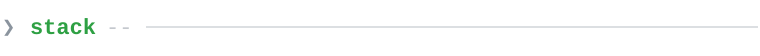
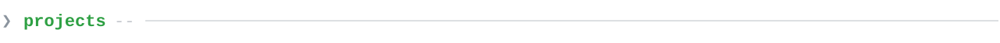
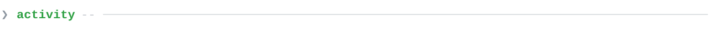

  

 

<table width="100%">
  <tr>
    <td width="62%" valign="top">
      
      

        &nbsp;&nbsp;
        &nbsp;&nbsp;
        &nbsp;&nbsp;
        
      

      

        &nbsp;&nbsp;
        &nbsp;&nbsp;
        &nbsp;&nbsp;
        
      

      

        &nbsp;&nbsp;
        &nbsp;&nbsp;
        &nbsp;&nbsp;
        
      

      

        I'm a software engineer and product builder interested in designing
        and building software systems that solve real-world problems.
        I enjoy working across the engineering process — from understanding
        business requirements and shaping system architecture to data modeling,
        backend development, and user-facing applications.
      

      

        My current focus is on business software, reliable backend systems,
        and the infrastructure needed to build, deploy, and operate them.
        I also explore how AI can support practical software engineering
        and remove repetitive work.
      

    </td>
    <td width="38%" valign="top" align="center">
      
    </td>
  </tr>
</table>

<table width="100%">
  <tr>
    <th align="left" width="14%">Year</th>
    <th align="left" width="24%">Project</th>
    <th align="left" width="22%">Stack</th>
    <th align="left">What it is</th>
  </tr>
  <tr>
    <td><code>2026</code></td>
    <td><b>DurianOS</b></td>
    <td>C# · .NET · React · TypeScript</td>
    <td>An ERP and operations platform for durian packing houses, covering receiving, weighing, grading, inventory, and grower settlement.</td>
  </tr>
  <tr>
    <td><code>2026</code></td>
    <td><b>PPK Laravel</b></td>
    <td>PHP · Laravel</td>
    <td>A hospital-focused web application project.</td>
  </tr>
  <tr>
    <td><code>2025</code></td>
    <td><b>R12 Welfare POS</b></td>
    <td>Node.js · Express · SQLite</td>
    <td>An inventory and point-of-sale system with stock control, sales records, and reporting.</td>
  </tr>
</table>

Some projects and client work are maintained in private repositories.

  

  

